<!--
  Yahia Rachek — Full-Stack Engineer & AI Orchestration Engineer
  PERN stack (PostgreSQL, Express, React, Node.js) · TypeScript · Agentic AI · Enterprise ERP · Traceability systems
  Portfolio: https://yahia-rachek.vercel.app
-->

  

I design and build <b>enterprise ERP platforms</b> and <b>industrial traceability systems</b> — from the database schema to the last pixel of the interface.
Full <b>PERN stack</b> <i>(PostgreSQL · Express · React · Node.js)</i>, <b>TypeScript everywhere</b>, and <b>agentic AI</b> woven into real business workflows.

 

  

   

  

<picture>
  <source media="(prefers-color-scheme: dark)" srcset="https://streak-stats.demolab.com?user=YRACHEK101&hide_border=true&border_radius=24&background=0d1117&ring=f5f5f7&fire=c3a6ff&currStreakLabel=f5f5f7&sideLabels=a1a1a6&currStreakNum=f5f5f7&sideNums=f5f5f7&dates=6e6e73&stroke=30363d" />
  
</picture>

  

<picture>
  <source media="(prefers-color-scheme: dark)" srcset="https://github-readme-activity-graph.vercel.app/graph?username=YRACHEK101&hide_border=true&radius=24&bg_color=0d1117&color=a1a1a6&title_color=f5f5f7&line=c3a6ff&point=f5f5f7&area=true&area_color=c3a6ff" />
  
</picture>

   

  

  

