<!--
  Yahia Rachek — Full-Stack Engineer & AI Orchestration Engineer
  PERN stack (PostgreSQL, Express, React, Node.js) · TypeScript · Agentic AI · Enterprise ERP · Traceability systems
  Portfolio: https://yahia-rachek.vercel.app
-->

<b>Yahia Rachek</b> is a <b>Technical Lead</b> and <b>Full-Stack &amp; AI Engineer</b> based in Morocco. 
I design and build <b>enterprise ERP platforms</b>, <b>industrial traceability systems</b> and <b>agentic AI pipelines</b> — from the database schema to the last pixel of the interface,
on the <b>PERN stack</b> <i>(PostgreSQL · Express · React · Node.js)</i> with <b>TypeScript everywhere</b>. 
Creator of <a href="https://www.stackandskill.com"><b>Stack &amp; Skill</b></a> — a reviewed publication where developers share real engineering problems they solved.

 

Profile — in plain text

 

### Yahia Rachek — Technical Lead · Full-Stack &amp; AI Engineer

**Yahia Rachek** (GitHub: [@YRACHEK101](https://github.com/YRACHEK101)) is a Technical Lead and Full-Stack &amp; AI Engineer based in Morocco. He designs and builds enterprise ERP platforms, industrial traceability systems and agentic AI pipelines, end to end, and created Stack &amp; Skill (stackandskill.com), with TypeScript, React, Next.js, Node.js, Express, Prisma and PostgreSQL.

| | |
|---|---|
| **Role** | Technical Lead · Full-Stack Engineer · AI Orchestration Engineer |
| **Location** | Morocco |
| **Specialties** | Enterprise ERP, industrial traceability, agentic AI, LLM orchestration, software architecture |
| **Stack** | TypeScript, React, Next.js, Vite, Tailwind CSS, Node.js, Express, Prisma, Zod, GraphQL, PostgreSQL, Redis |
| **Delivery** | Docker, Nginx, GitHub Actions, Jest, Playwright, SonarQube |
| **AI** | Claude (Anthropic), agentic workflows, multi-step LLM orchestration, RAG |
| **Stack &amp; Skill** | [stackandskill.com](https://www.stackandskill.com) — community publication for developers: real-world engineering problems, editor-reviewed. Next.js 16, React 19, PostgreSQL, Prisma |
| **Open source** | [portbridge](https://github.com/YRACHEK101/portbridge) · [Vector](https://github.com/YRACHEK101/Vector) · [gity](https://github.com/YRACHEK101/gity-tool) — developer tools published on npm |
| **Portfolio** | [yahia-rachek.vercel.app](https://yahia-rachek.vercel.app) |
| **LinkedIn** | [linkedin.com/in/yahia-rachek-47b964304](https://www.linkedin.com/in/yahia-rachek-47b964304/) |
| **Email** | [r.yahia.dev@gmail.com](mailto:r.yahia.dev@gmail.com) |

#### Frequently asked

**Who is Yahia Rachek?**
A Technical Lead and Full-Stack &amp; AI Engineer from Morocco who builds enterprise ERP platforms, industrial traceability systems and agentic AI pipelines on the PERN stack with TypeScript.

**What does Yahia Rachek build?**
Modular, multi-tenant ERP systems; lot tracking and end-to-end supply-chain traceability; type-safe REST APIs with Prisma and Zod; and AI agents for stock management, forecasting and decision support.

**Which technologies does he use?**
PostgreSQL, Express, React and Node.js (PERN), Next.js, TypeScript, Prisma, Redis, Docker and Claude for agentic AI.

**What is Stack &amp; Skill?**
[Stack &amp; Skill](https://www.stackandskill.com), created by Yahia Rachek, is a community publication for developers: members share real-world engineering problems they solved, editors review every submission, and contributors earn points, levels and badges. It is built with Next.js 16, React 19, TypeScript, Tailwind CSS, PostgreSQL and Prisma.

**Has he published open-source work?**
Yes — three developer tools on npm: [portbridge](https://github.com/YRACHEK101/portbridge) (`npx portbridge`), [Vector](https://github.com/YRACHEK101/Vector) (`npx vector-migrate@latest`) and [gity](https://github.com/YRACHEK101/gity-tool) (`npm i -g gity-tool`).

**How can I contact Yahia Rachek?**
By email at r.yahia.dev@gmail.com, on [LinkedIn](https://www.linkedin.com/in/yahia-rachek-47b964304/), or through his portfolio at [yahia-rachek.vercel.app](https://yahia-rachek.vercel.app).

 

